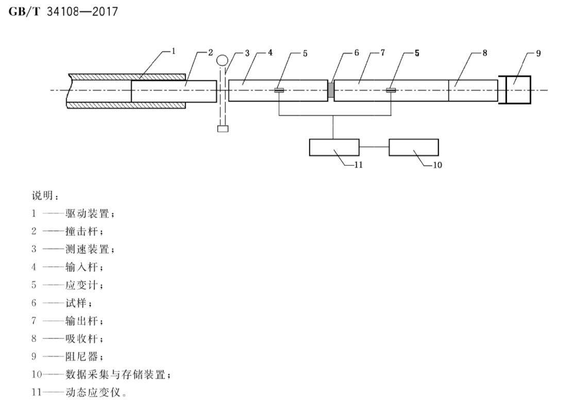
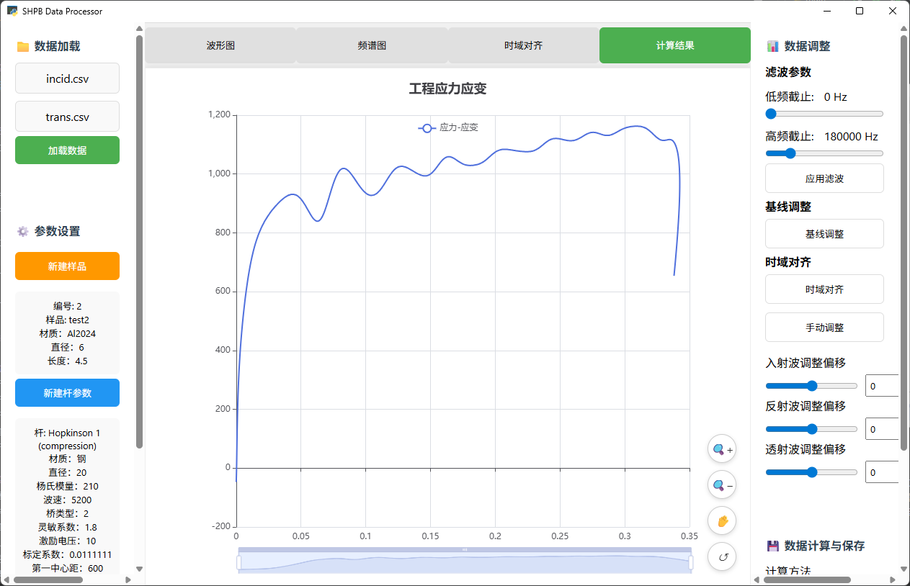
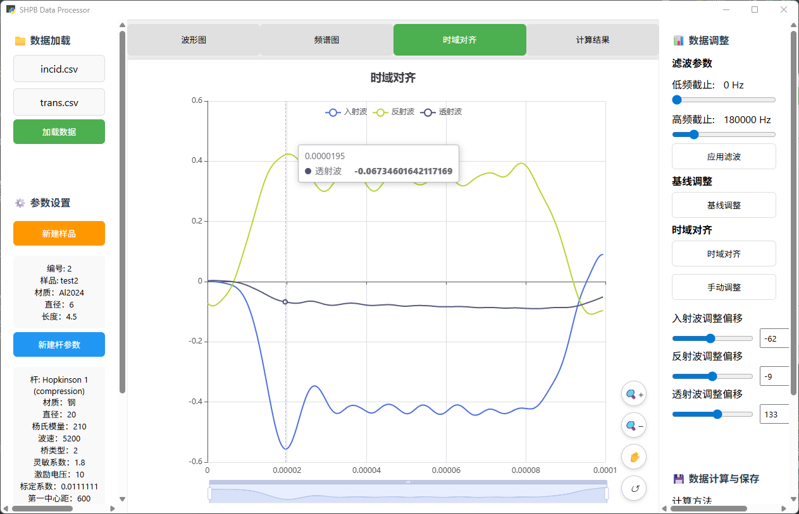

# 霍普金森杆（Hopkinson Bar）数据处理软件
[English](README_EN.md) | [中文](README.md)

## 1. 霍普金森杆简介

###  工作原理
霍普金森杆（Hopkinson Bar）是一种用于测试材料在高应变率下力学性能的实验设备。该技术由英国科学家Bertram Hopkinson在20世纪初发明，主要用于研究材料在动态载荷下的应力-应变关系。

霍普金森杆系统主要由入射杆、透射杆和吸收杆组成，通过应力波在杆中的传播来测量材料的动态力学性能。



## 2. 软件使用说明

### 2.1 程序依赖

本软件使用python以及java进行开发。其中python所需要的库列举如下
```
pip install numpy scipy pandas pywebview
```

### 2.2 软件界面



### 2.3 操作流程
1. **数据加载**：导入入射波和透射波数据文件
点击左上角选择入射波文件以及透射波文件，并点击“加载按钮”按钮进行导入，文件类型一般为csv格式，数据格式为两列，第一列是时间轴，第二列是波形数据。

2. **参数设置**：配置样品参数和杆参数
新建样品：填写样品参数，并点击“保存”按钮保存。需要填写的内容有：样品编号、样品名称、样品材质、截面直径、样品长度。
新建杆：填写杆参数，并点击“保存”按钮保存。需要填写的内容有：
杆模式、 杆材质、截面直径、Young's模量、声速、入射/透射杆标定系数、泊松比、阻尼系数等。

3. **数据选择**
在原始数据中按住Ctrl后使用鼠标左键拖动选择入射波、反射波、透射波数据范围

4. **数据处理**：进行高频滤波、基线调整、时域对齐等处理
高频滤波：入射波与透射波可分别选择滤波器类型（巴特沃斯、切比雪夫、汉明窗 FIR）并设置高频截止频率，滤波为零相位实现，不引入时间偏移。
基线调整：输入波形数据后，点击“基线调整”按钮，根据提示移动滑块进行基线调整。
时域对齐：直接点击会将三个波形按时间对齐，一般不够准确，点击“手动调整”按钮，根据提示手动调整时间轴对齐。
手动调整：点击“手动调整”按钮，根据提示手动调整滑块对三个波形进行时间轴对齐。一般来说，取波形的第一个峰作为对齐标准，示意如下：



5. **计算分析**：选择合适的计算方法进行数据分析
选择计算方法后，不同的计算方法计算效果有所差距，根据需要选择合适的方法，可参考[国标](https://openstd.samr.gov.cn/bzgk/std/newGbInfo?hcno=D484174464EFFF3C22B1B8CEABF87E20)
 选择。点击“计算”按钮进行计算。

6. **结果导出**：保存处理结果
点击“保存”按钮，选择文件保存路径后，将处理结果保存为csv文件以及样品和杆配置json信息。

## 3. 参数说明

### 3.1 样品参数
- **样品编号**：唯一标识样品的编号
- **样品名称**：样品的名称或描述
- **样品材质**：样品的材料类型
- **截面直径**：样品的截面直径（mm）
- **样品长度**：样品的长度（mm）

### 3.2 杆参数
- **杆模式**：压杆或拉杆模式
- **杆材质**：杆的材料类型
- **截面直径**：杆的截面直径（mm）
- **Young's模量**：杆的弹性模量（GPa）
- **声速**：应力波在杆中的传播速度（m/s）
- **入射杆标定系数**：将入射杆电压换算为应变的标定系数
- **透射杆标定系数**：将透射杆电压换算为应变的标定系数
- **泊松比**：杆材料的泊松比
- **阻尼系数**：系统阻尼系数

### 3.3 计算参数
- **计算方法**：
  - 双波法（入射+透射）
  - 双波法（反射+透射）
  - 三波法

## 4. 国家标准参考

### 4.1 主要标准
本软件参考以下国家标准进行开发：

[GB/T 34108-2017](https://openstd.samr.gov.cn/bzgk/std/newGbInfo?hcno=D484174464EFFF3C22B1B8CEABF87E20)
 《 Hopkinson杆法测定金属材料动态压缩力学性能的试验方法》

## 5. 联系方式

如有问题或建议，请联系：
- 开发人员：[Tang Lifa(SWJTU)]()
- 邮箱：[联系方式]()
- 项目地址：[Hopkinson](https://github.com/Mr-tang0/Hopkinson.git)